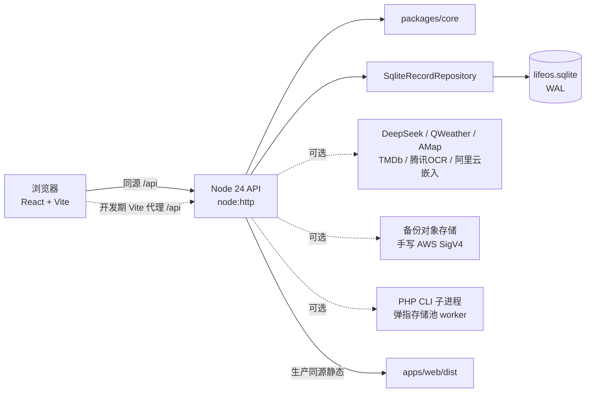

# LifeOS 运行与接线指南

> **本文是什么**：写给「第一次进场的后来人 / AI」的一份**操作型**指南 —— 只回答三件事：
> **① 各个部件之间怎么接；② 怎么把它跑起来；③ 有哪些后台定时任务、什么时候跑、什么条件才跑。**
>
> **本文不是什么**：不是产品说明，也不是设计规范。需求看 `docs/requirements.md`，为什么这么设计看
> `docs/architecture.md`，协作规则看 `AGENTS.md`，改过什么看 `docs/changelog.md`，还剩什么看 `docs/todo.md`。
> **与它们冲突时，一律以它们为准。**
>
> **分工声明**：本文**只覆盖「接线 + 运行 + 定时」**这一块，且只写撰写者**亲自读过源码核对过**的部分。
> 其他模块（UI 设计、检索模型选型、OCR 全链细节、验收方法论等）由别的窗口补，本文不越界、也不编造。
>
> **快照时间**：2026-10-16（Asia/Shanghai）。代码在动，行号会漂；结论用文末「自查命令」复验。

---

## 0. 一句话

LifeOS 是 **monorepo（npm workspaces）** 的**自托管个人时间轴应用**：
浏览器界面（React/Vite）→ 零框架 Node 24 HTTP API → `node:sqlite` 单文件库。默认**不连任何第三方**也能完整记录与浏览。

```
packages/core   领域模型 / 校验 / @#提及解析 / 摘要 / 导出 —— 纯逻辑，不含存储实现
apps/api        Node 24 node:http + node:sqlite；认证、路由、备份、可选外部集成
apps/web        React 19 + Vite 7 界面；唯一 API 客户端 apps/web/src/api.ts
scripts/        启动器、演示数据、SQLite 备份、整站备份/校验/恢复
.review/        ⚠️ 验收工具箱（300+ 脚本，**被 gitignore，不随仓库走**）
data/           ⚠️ 生产数据目录（库 + 配置 + 备份 + 派生缓存）
profiles/       ⚠️ 档案卡（「换一个数据环境」的唯一做法）
```

---

## 1. 各部件之间怎么接

### 1.1 运行链路



要点（源码位置）：

| 连接 | 怎么接的 | 位置 |
| --- | --- | --- |
| Web → API | **同源** `/api`，`credentials: same-origin` | `apps/web/src/api.ts` |
| 开发期代理 | Vite 把 `/api` 代理到 `LIFEOS_API_ORIGIN ?? http://127.0.0.1:${LIFEOS_PORT ?? 3001}` | `apps/web/vite.config.ts` |
| API → 领域层 | API 只调用 `packages/core` 的模型/校验/提及/导出 | `packages/core/src/index.ts` |
| API → 数据库 | `SqliteRecordRepository`，**建表 DDL 全在构造函数里**，`STRICT` 表 + WAL | `apps/api/src/repository.ts` |
| 生产静态托管 | 非 `/api` 的 GET/HEAD 从 `LIFEOS_WEB_DIR ?? apps/web/dist` 出 | `apps/api/src/config.ts:161` |
| 进程装配 | `createApp()` 里一次性 new 出所有调度器并 `start()` | `apps/api/src/server.ts:364-680` |

### 1.2 配置写在两处，优先级不同（**这是最容易搞混的地方**）

| 写法 | 落在哪 | 何时生效 | 适用 |
| --- | --- | --- | --- |
| **`.env`**（项目根） | 进程环境变量 | **改完必须重启** | 部署、密钥、S3、代理、开关 |
| **设置页保存** | `data/<模块>-config.json`（**AES-256-GCM 加密**） | 下一次请求即生效，**不用重启** | 日常换 key / 换城市 |
| 进程环境变量 | 内存 | 立即 | `.review/` 脚本临时注入 |

- 启动方式：`node --use-env-proxy --env-file-if-exists=.env apps/api/dist/src/main.js`（见 `package.json` 的 `start`，
  `scripts/dev.mjs` 同款）。`.env` 必须 **UTF-8 无 BOM** —— 有 BOM 时**第一个变量名被静默吃掉**。
- **`.env` 与设置页同时存在时，以能生效的那个为准**：例如高德 key，设置页里存过的优先，清掉才回落到 `LIFEOS_AMAP_API_KEY`（`.env.example:109-112`）。
- **账户模式的服务凭据共用**（2026-10-22核对）：AI／天气／高德／观影从管理员的有效配置读取，既包括 `.env`，也包括管理员设置页保存的 Key；普通账号默认借用，不复制密文到个人配置。管理员在页面换 Key 后，已创建的成员服务实例下次请求即取新值；`.env` 改动仍须重启 API。腾讯 OCR 与 DashScope 嵌入凭据直接沿用服务器配置。城市、各模块开关、AI 偏好与检索索引仍各自独立。已有明确个人 Key 保持原优先级；坏密文保留，不能靠留空保存抹掉。共享凭据只在 API 进程内使用，AI／天气限定管理员批准的目标，地图／观影固定供应商接口且不跟随跳转。实现见 `tenant-config.ts`／`server.ts` 的 `sharedIntegrationsForMembers`；复验 `apps/api/test/shared-integrations.test.ts`、`.review/verify-shared-services-browser.mjs`，仅用自建隔离实例。
- ⚠️ **手写 config json 无效**：`data/ai-config.json` 等是加密的，绕过 UI 直接写文件解不开。要绕开 UI 就写 `.env` 并重启。

### 1.3 API JSONL 日志

- 请求日志位于 `logs/api-YYYY-MM-DD.log`；默认是数据目录旁的 `logs/`，也可用 `LIFEOS_LOG_DIR` 指定。日期文件按 UTC 切换。
- 搜索 `day_summary_ai_fallback` 可查日历 AI 小结何时退回规则摘要。事件只含入口、日期、provider/model、失败类别，以及适用时的 HTTP 状态或网络错误码；不记录记录正文、模型回复、服务地址或密钥。离线规则模式是预期行为，不记失败。
- 兜底仍正常返回 HTTP 200；需要定位时，以结构化事件中的 `reason` 为准，不要只看请求状态码。旧请求日志不含被吞掉的模型错误，无法事后补出失败原因。
- 搜索 `assistant_reply_diagnostic` 可查“正文已交付、附加信息未采用”的聊天兼容事件；它们不是整轮失败，不计入失败列表。事件带对话／轮次、原因码、字符计数及有界原始回复（最多64000字符，超过保留头尾），可能含个人正文，不含请求密钥；排查时与本轮聊天时间对照，勿仅查询 `status=failed`。完全空白的失败记录另保留转义空白与实际思考有无，避免把“收到字符”误认成“有答案”。

---

## 2. 怎么把它跑起来

### 2.1 环境要求

- **Node ≥ 24**（`package.json` 的 `engines`；`node:sqlite` 的 `DatabaseSync` 与 `--env-file-if-exists` 都依赖它）。
- Windows 本机跑 `npm test` 有已知坑：**先 `export PATH="/c/Program Files/nodejs:$PATH"`**。
  因为 `npm test` 内层的 `node --test` 按 PATH 找 node，而 PATH 里的 managed 22.x 不支持 `--test-isolation=none`。

### 2.2 命令表

```bash
npm install
npm run dev        # 构建 core+api，然后 API + Vite 一起起（开发用，见 scripts/dev.mjs）
npm run build      # core → api → web 顺序构建
npm start          # 单进程生产模式：API 同源托管 apps/web/dist
npm run typecheck  # core / api / web 三份
npm test           # core + api + web + instance-backup + ui-policy 五段
npm run seed:demo  # 灌虚构演示数据（--clean 清理）
npm run backup -- data/lifeos.sqlite backup/lifeos.sqlite   # 单库一致性快照（scripts/backup.mjs）
```

`npm run dev` 的行为（`scripts/dev.mjs`）：先同步构建 `@lifeos/core`、`@lifeos/api`，再**并行 spawn 两个子进程**
（API 用 `--use-env-proxy --env-file-if-exists=.env`；Vite 绑定 `127.0.0.1`）。任一子进程非 0 退出则整体关闭。
`LIFEOS_WEB_PORT` 只在「另有一个 Vite 在跑」时才需要设。

### 2.3 端口地图（**不要乱改**）

| 端口 | 用途 | 谁在占 |
| --- | --- | --- |
| **3001** | API 默认端口（`DEFAULT_PORT`） | 开发 / 生产。**主人自己占用的端口永不可杀** |
| **5173** | Vite 开发端口（`strictPort: true`） | `npm run dev` |
| **3011 / 5199** | **预览：API / Web**。两扇门共用这一个 5199：`启动预览.cmd` = 只绑 loopback、无密码、**管理员页在**；`启动局域网预览.cmd` = Web 绑 `0.0.0.0`、**要登录**、管理员页关 | `scripts/preview.mjs` → `.review/accept-serve.mjs` **唯一有权占用**；服务的就是生产库 `data/` |
| **3041 / 5499** | 卡片 Demo 门（局域网可访问、要登录、无管理员页）。**已不是双击入口**，只在想给手机看虚构 Demo 时手动起 | `node .review/profile-serve.mjs demo-chenyu-backfill --port 3041 --web-port 5499 --lan` |
| 3021/5299、3041/5499… | 隔离实例（卡片、验收用） | 各 `verify-*.mjs` / `profile-serve.mjs` 自己起，**收尾必须停干净** |

### 2.4 把「主人的应用」跑起来（预览，5199）

```bash
# 先在项目根跑；沙箱里 esbuild 会 spawn EPERM，需要 dangerouslyDisableSandbox
node .review/accept-serve.mjs      # 拉起 API 3011 + Web 5199（默认只对本机）
node .review/stop-accept-serve.mjs # 只关它那一棵树（读 serve-pids.json）
```

- 根目录两个双击入口，共用 3011/5199，**双击哪个就是哪个模式**（`scripts/preview.mjs`）：
  - `启动预览.cmd` → 只绑 `127.0.0.1`、不要密码、**保留管理员分组与「账户/存储」页**。坐电脑前用这个。
  - `启动局域网预览.cmd` → `--lan`：Vite 绑 `0.0.0.0`、**强制登录**（密码打印在窗口，也存 `.review/run/lan-password.txt`）、**管理员页关闭**、跑的仍然是 `data/`（**本机这份是调试副本，正式资料在宝塔那台**，见下方目录树）。手机同 Wi-Fi 打开窗口里那个 `http://<本机IP>:5199/`。
  - 从本机模式切到局域网模式（或反过来）：直接双击另一个即可 —— `preview.mjs` 会先收掉旧实例（只碰 3011/5199）再起新的，并打印它做了什么。
- **管理员页为什么在局域网模式下消失**：`apps/api/src/config.ts:206` 只允许「loopback + 无密码 + 非账号模式」带 `LIFEOS_LOCAL_PREVIEW_ADMIN`。经 Vite 代理，API 分不出「手机」和「本机」，给不了本机特权。要管理员页就用 `启动预览.cmd`。
- **手机能绑上却打不开 → 先查防火墙，不是绑定**：这台机器网络被标成「公用」，Node 没有任何入站规则。`--lan` 启动时自己查这条规则，**缺了就直接跑 `scripts/allow-lan-firewall.ps1` 弹一次 UAC**（拒绝不影响本机使用；`LIFEOS_NO_FIREWALL_PROMPT=1` 可跳过）。`允许手机访问.cmd` 是手动兜底，两个入口是同一个脚本。
- Origin 白名单由启动器每次启动重算（`scripts/lib/lan-preview.mjs`），DHCP 换 IP 也不会 403，别手工覆盖 `LIFEOS_ALLOWED_ORIGINS`。
- 拉起后打开 `http://127.0.0.1:5199/`。**端口已经 200 就别重拉**（重拉会撞「端口被占」）。
- 已知假故障：`5199` 挂了但 `3011` 正常 → 先看 `.review/run/web.log` 尾部，多半是启动期 `spawn EPERM`，
  或跑到一半被沙箱的 `SAFE_DELETE_BULK_REJECTED` 打断 Vite 的 `runOptimizer`。**都不是产品坏了。**
- 手机经局域网 `http://` 访问时是非安全上下文：`crypto.subtle` 与 `navigator.clipboard` 不可用。
  上传会退回普通方式（功能正常），复制按钮会提示手动复制。这是浏览器限制，不是 bug。
- 验收：`node .review/verify-lan-preview.mjs`（隔离实例 3021/5299，覆盖 LAN 绑定、登录、Origin 拒绝）。

#### 卡片 Demo 门：5499（手动起，已不是双击入口）

想看**虚构 Demo**（415 张照片那套）而不是 `data/` 里那份调试副本时才用它。项目根跑：

```bash
node .review/profile-serve.mjs demo-chenyu-backfill --port 3041 --web-port 5499 --lan
```

- **卡名写死成 `demo-chenyu-backfill`**，不是按 `profiles/.active`。跟随指针等于「双击时手机上是谁的库」由上一次切卡决定——5499 要的只是那套 415 张照片的虚构 Demo。窗口横幅会打印实际卡片、库与照片目录，可以对照：库应是 `profiles/demo-chenyu-backfill/data`。
- 想换展示的卡：改 cmd 里的卡名（或用 `profile.mjs new` 造一张），别删掉卡名。
- **只开放 Web 端口**：Vite 绑 `0.0.0.0:5499`，API 仍只听 `127.0.0.1:3041`；手机跑 `http://<本机局域网 IP>:5499/`。
- **必须登录**，密码取 `LIFEOS_LAN_PASSWORD` / `LIFEOS_PASSWORD`（env 或 `.env`），都没有就自动生成一次存 `.review/run/lan-password.txt`；窗口横幅会打印手机地址和密码。
- **这个实例不是管理员**：不注入 `LIFEOS_LOCAL_PREVIEW_ADMIN`，所以设置页没有「管理员」分组和「账户/存储」页。5199 的局域网模式同样是这个限制——那是安全边界，不是漏配。
- **不和 5199 共用库**：两份数据目录、两份照片目录完全分开（这是卡片机制的红线）。所以手机上做的改动不会出现在 5199。
- **停止**：Ctrl+C，或直接关掉那个 cmd 窗口（会清 `profile.lock` 与 `serve-pids-5499.json`）。
- **别指望 `stop-accept-serve.mjs` 停它**：那个脚本只管 3011/5199 那一棵树。5499 的进程记录单独写在 `.review/run/serve-pids-5499.json`，不会覆盖 5199 的 `serve-pids.json`。
- **端口被占**：多半是上一轮的旧实例（`netstat -ano | findstr :5499` 找到 pid，确认是自己的后再 `taskkill /PID <pid> /T /F`）。
- 验收：`node .review/verify-lan-preview.mjs` 的 B 段（隔离卡 + 3051/5511，不碰 3041/5499 上的既有实例）。

### 2.5 按「档案卡」起实例（换数据环境的唯一做法）

```bash
node .review/profile.mjs list|show|new|clone|activate|rm   # 卡片管理
node .review/profile-serve.mjs [<卡名>] [--port 3011 --web-port 5199]   # 不给卡名就按 profiles/.active 指针
```

- **冻结 / 释放 = 只改 `profiles/.active` 指针，目录一个字节都不搬** ⇒ 库、`derived/`、OCR 结果原地保留，切回来直接命中。**没有「解冻」这个动作。**
- 启动器按卡注入 `LIFEOS_DATA_DIR` / `LIFEOS_ASSET_ROOT` / `LIFEOS_BACKUP_DIR` / `BACKUP_S3_PREFIX`，
  非真档案额外注入 `VITE_LIFEOS_PROFILE`（浏览器键按卡加前缀）。
- ⚠️ **`profiles/` 是主人的档案卡，不是缓存 —— 永不删、永不清。**

---

## 3. 各个「地方」怎么接

### 3.1 外部服务接线表

> 口径：**没配会怎样**才是关键 —— 这个项目的设计原则是「不配也能用」。

| 服务 | 配置项（形状） | 配了之后 | **没配会怎样** |
| --- | --- | --- | --- |
| **DeepSeek（日摘要 + 只读助手）** | `LIFEOS_DEEPSEEK_API_KEY` / `_MODEL`（默认 `deepseek-flash`）/ `_BASE_URL`（默认 `https://api.deepseek.com`） | 日摘要与 AI 助手走真实模型 | **回退本地规则**，日历照常能浏览 |
| **语义检索嵌入（阿里云百炼 DashScope）** | `DASHSCOPE_API_KEY` + `LIFEOS_EMBEDDING_BASE_URL` / `_MODEL`（默认 `text-embedding-v4`）/ `_DIMENSIONS`（默认 1024）；`LIFEOS_EMBEDDING_ENABLED=false` 可暂停 | 日记向量索引，语义检索 | **只跑词法检索**，功能不报错 |
| **天气（和风 QWeather）** | `QWEATHER_KEY` / `QWEATHER_LOCATION` / `QWEATHER_CITY` / `QWEATHER_HOST`（默认 `devapi.qweather.com`），或设置页保存 | 顶栏天气动画 + 按日预报 + 归档 | 天气区块不显示 |
| **高德 AMap** | `LIFEOS_AMAP_API_KEY` | IP 兜底定位 + 地点 POI 搜索 | IP 定位不可用（浏览器定位不受影响） |
| **腾讯云 OCR** | `LIFEOS_TENCENT_SECRET_ID` **和** `_SECRET_KEY`（**两半都要**）、`_OCR_REGION`（默认 `ap-guangzhou`，**必须国内区**）、`_OCR_ACTIONS`（默认 `GeneralBasicOCR`） | 照片文字识别（书页/菜单/小票/招牌） | **只写了 SecretId 会被忽略** —— 半套凭证永远不算已配置 |
| **观影 TMDb** | `LIFEOS_TMDB_API_KEY` 或 `TMDB_API_KEY` | 片名识别 | 观影模块静默关闭，**不删已保存的电影** |
| **备份对象存储** | `BACKUP_S3_ENABLED/ENDPOINT/REGION/BUCKET/PREFIX/FORCE_PATH_STYLE/ACCESS_KEY_ID/SECRET_ACCESS_KEY` | 每日双备份（本地 + 对象存储） | **纯本地备份模式** |
| **整站异地备份** | `LIFEOS_INSTANCE_BACKUP_S3_BUCKET`（**必须显式填**，不沿用上面的桶）+ 可选 `_ENDPOINT/_REGION/_PREFIX/_FORCE_PATH_STYLE/_ACCESS_KEY_ID/_SECRET_ACCESS_KEY` | `scripts/run-instance-backup-pm2.sh` 可用 | 脚本直接拒绝运行 |
| **弹指存储池（PHP）** | `LIFEOS_STORAGE_POOL_ENABLED=1`、`LIFEOS_POOL_CONSUMER`（默认 `2`）、`LIFEOS_POOL_PHP_BINARY`（默认 `php`）、`LIFEOS_POOL_WORKER_PATH` | 通过 **PHP CLI 子进程**（`apps/api/php/pool-consumer-worker.php`）读写对象存储；API 只把 `PATH`/`SYSTEMROOT`/`TMP` 和 `LIFEOS_POOL_CONSUMER` 传给 PHP，**不整份透传环境** | 存储池相关 UI 报「尚未启用」 |
| **出网代理** | `HTTPS_PROXY` / `NO_PROXY` | 海外服务走代理 | 直连。**必须靠 CLI 的 `--use-env-proxy`**：Node 只在 bootstrap 阶段读 `NODE_USE_ENV_PROXY` **变量**，写在 `.env` 里无效 |

补充口径：

- **账号 / 多租户**：`LIFEOS_ACCOUNT_MODE=1` 显式开启；首次引导需 `LIFEOS_OWNER_USERNAME` + ≥10 字符 `LIFEOS_PASSWORD`，
  **建好后两个引导值都要删掉并重启**；并要求显式 `LIFEOS_ALLOWED_ORIGINS`（只允许 HTTPS，或回环 HTTP 本地预览）。
- **认证**：回环绑定可无密码；绑非回环时 `LIFEOS_PASSWORD` 必填（`config.ts:158`）。
- **网络边界**：`LIFEOS_HOST`（默认 `127.0.0.1`）、`LIFEOS_BODY_LIMIT_BYTES`（默认 1 MiB）、
  `LIFEOS_ASSET_UPLOAD_LIMIT_BYTES`（默认 25 MiB）、`LIFEOS_COOKIE_SECURE`。
- **资产**：`LIFEOS_ASSET_ROOT` 指照片原件目录（本机 = `pic-test/`），**LifeOS 只读引用、绝不复制原件**。
- **信任代理**：只在**本机可信反代且会覆盖 `X-Real-IP`** 时设 `LIFEOS_TRUST_PROXY=1`。

### 3.2 🔑 加密种子四件套（**最阴的一个坑**）

```
LIFEOS_AI_CONFIG_SECRET
LIFEOS_WEATHER_CONFIG_SECRET
LIFEOS_MOVIE_CONFIG_SECRET
LIFEOS_BACKUP_CONFIG_SECRET
```

种子推导顺序：`LIFEOS_<模块>_CONFIG_SECRET` → `LIFEOS_PASSWORD` → `` `lifeos-local-<模块>:${dataDirectory}` ``。

⇒ **后两者都没设时，种子就是数据目录路径本身。** 一旦搬数据目录 / 改 `LIFEOS_PASSWORD`，
**已保存的 API key 会静默解不开**（设置页只显示「未配置」，**零报错**）。所以 `.env` 里这四个是
**故意钉成历史路径的：别删、别改**。另有两条配套事实：

- **「测试连接」不落盘** ⇒ 成功 ≠ 已保存。量尺：`.review/verify-ai-key-persist.mjs`。
- **凭据是全局一份，按卡只分设置不分凭据**（主人 2026-10-16 明确：「key 大家一起用，并没有分用户」）。

---

## 4. 定时任务（后台自动化）

> **重要前提**：下面**全部是 API 进程内的 `setTimeout` 定时器**，不是系统 cron。
> ⇒ **进程不在 = 任务不跑**；重启后各自的「补齐 / 去重」策略见下表的「重启行为」列。
> ⇒ 所有时刻都以 **`Asia/Shanghai`** 计算，**与主机时区无关**（`Intl.DateTimeFormat` 显式指定时区）。
> ⇒ 装配点统一在 `apps/api/src/server.ts:364-680` 的 `createApp()`。

| 任务 | 时刻 / 触发 | 实现 | 重启行为 | 开关 / 前置条件 |
| --- | --- | --- | --- | --- |
| **每日备份** | 默认 **02:00**（可改），**默认关闭** | `backup-scheduler.ts` | 启动时读库里的 `backup_schedule` 重新计算下一次；**用 `claimBackupScheduleRun(key)` 在 SQLite 里抢占**，重启或重复定时器都不会跑两遍 | 设置页开启；`enabled=false` 时 `nextRunAt()` 返回 `null` |
| **资产回收（孤儿照片）** | 固定 **03:30**（备份占 02:00，它让到 03:30） | `asset-gc-scheduler.ts` | **启动时立刻先跑一次**（老装机可能几周没重启），再排 03:30 | **无开关**；`canRun: () => !poolServices?.transition?.localPrimary` —— 存储池迁移到「本地为主」时跳过 |
| **天气归档** | **23:55** 归档当天/前一天最终快照 | `weather-archive-scheduler.ts` | 启动即 `#runDue()`：任何时候重启都会**补查昨天**，若已过 23:55 连**今天**也一起查 | 无独立开关；天气没配则 `fetchRealtimeWeather` 返回 `null` 直接跳过 |
| **天气逐时观测** | **每个整点** | 同上（`#armObservation`） | 重新对齐到下一个整点 | 同上；按 location 去重，多 profile 指同一地点只调一次外部接口 |
| **日记向量索引** | 保存后**合并 30s**（`#notBefore = now + 30s`）；**每晚 03:00 全量补扫** | `journal-memory.ts` 的 `JournalMemoryIndexer` | 定时器 `.unref()`（**不阻止进程退出**）；靠持久化的 chunk hash **续跑**，不重算 | **需要 `journalEmbedding` 配置**（`DASHSCOPE_API_KEY` 且未被 `LIFEOS_EMBEDDING_ENABLED=false` 关掉），否则 `start()` 直接返回 |
| **照片文字识别（OCR）** | 记录保存后**防抖 5s** 触发 | `photo-text-trigger.ts` | **单飞 + 合并**：一批保存只跑一趟；每趟最多 **5 个切片**、每片 **20 张**、片间停 **1.5s**（把事件循环让给浏览器） | 需 `tencentOcr` **且**设置里开关为开（`#canRead()` 每次保存现读，改开关**不用重启**） |
| **助手失败日志清理** | 每天一次（**挂在写入路径上**，不是定时器） | `assistant-attempt-log.ts:100` | 记录 `prunedDay`，跨天后的第一次写入触发 | 保留 **30 天**（`ATTEMPT_RETAIN_DAYS`） |
| **日历派生重算** | **每天午夜后 +20ms** | `calendar-days.ts:44`（另有 `calendar-backgrounds.ts`） | 定时器 `.unref()`；`schedule()` 默认还有 750ms 防抖 | 无开关 |

### 4.1 读表要点

- **备份默认是关的**（`DEFAULT_BACKUP_SCHEDULE = { enabled: false, hour: 2, minute: 0 }`，`repository.ts:145`）。
  看到「没有自动备份」先确认设置页里开了没有，别急着当 bug。
- **去重靠数据库，不靠内存**：备份用 `backup_schedule` 表里的 run key 抢占；天气归档靠 `weather_day_cache` 缓存行；
  资产 GC 的三条收集条件**每次都从库里重新推导**，不依赖记忆状态。所以这些任务**重入是安全的**。
- **要手动跑一次**：各自的 `runOnce()` / `takeObservation()` 是给测试和运维的显式钩子（见上表源码）。
- 触发类任务（OCR / 向量索引）**永不阻塞保存**：写入先应答，任务在后面跑；失败也只是「下一趟再来」，不会让保存失败。

---

## 5. 数据落点地图

```text
data/                                  ⚠️ 生产数据目录（本机 = 测试副本，正式资料在宝塔那台）
├─ lifeos.sqlite (+ -wal / -shm)       生产库
├─ identity.sqlite                     身份库（仅 LIFEOS_ACCOUNT_MODE=1）
├─ tenants/<uuid>/                     成员租户（独立库 / assets / backups）
├─ ai-config.json / weather-config.json / movie-config.json / backup-config.json   加密的集成配置（**无 git、无副本**）
├─ backups/                            本地 SQLite 备份 + _trash/
├─ derived/snapshots/                  时光机快照（**只读穿越用**）
├─ derived/thumbs/                     派生 webp 缩略图缓存
└─ DO-NOT-DELETE.md                    防误删警戒

pic-test/                              本机资产根（LIFEOS_ASSET_ROOT），**没有备份**
profiles/                              档案卡（profiles/real 指向 data/ + pic-test/）
```

- **照片不在快照里**：S3 快照**只含数据库，不含资产**。资产目录必须自己另想办法。
- **搬 / 复制 sqlite 前必须 `PRAGMA wal_checkpoint(TRUNCATE)`**；运行中的 WAL 文件不能盲拷。
- **恢复三件事**：停 API → 删 `-wal`/`-shm` → 保留 config json。
- 单库备份**不包含** `identity.sqlite`、成员库、照片与 `data/*.json` ⇒ **不能单独用于多租户整站恢复**。
  整站恢复用 `scripts/backup-instance.mjs`（`backup` / `verify` / `restore`，`restore` **只接受不存在的目标目录**）。

---

## 6. 部署（宝塔 + PM2）

现有部署形态（`README.md:209-231`）：`/www/server/lifeos-app` + **Node 24** + **PM2 进程名 `lifeos`**；
Nginx 反代上游 `http://127.0.0.1:3001`，**不暴露公网直连端口**。**不用 Docker**（本机没有 Docker，Docker/NAS 链路至今未真机验证）。

### 6.1 整站本地 + 异地备份（**带计划任务**）

```bash
cd /www/server/lifeos-app
export LIFEOS_NODE_BIN=/www/server/nodejs/v24.21.0/bin/node
export LIFEOS_INSTANCE_DATA_DIR=/www/server/lifeos-data
export LIFEOS_INSTANCE_BACKUP_ROOT=/www/server/lifeos-private-backups   # 必须在数据卷之外
bash scripts/run-instance-backup-pm2.sh
```

脚本行为（`scripts/run-instance-backup-pm2.sh`，**只碰名为 `lifeos` 的 PM2 进程**）：

1. `flock` 独占锁（并发直接跳过）→ 确认 `pm2 pid lifeos` 在线（**不擅自启动或改变它的状态**）；
2. **先**用无害探针 `check` 私有桶（若匿名可读，**拒绝上传任何真实账号库和照片**）；
3. `pm2 stop lifeos` → 一致性整站快照 → `pm2 start lifeos`（`trap` 保证异常也尽力恢复服务）；
4. `verify` 校验 SHA-256 清单 → `upload` 异地，返回 `manifestKey`（**须安全保留**）。

- **先用同一脚本手动成功跑一次并完成恢复演练，再挂宝塔计划任务 / cron** 在低峰期每天跑；
  计划任务必须用**拥有 `lifeos` 的 PM2 用户**，并显式带上上面三个环境变量；失败要告警。
- 整站异地对象**暂不自动删除**（避免清理策略误删唯一恢复点），需要人工监测私有桶容量。

### 6.2 `git push` 之后（主人 2026-10-12 要求）

push 成功后**必须附宝塔拉取更新步骤**：源码拉取 → 依赖安装 → 构建 → 重启 → 版本核对，
并说明**本次预期提交号**；拉取或构建失败就**停下、不强制覆盖服务器改动**。
（部署路径 / 运行方式若变更，**先核对再写**。）

---

## 7. 红线（照做就行）

1. **`data/` 是生产库**：不 `rm`、不清空、不「重置预览数据」、不对它跑 `seed-demo --clean`。
   要干净数据 → 另开 `LIFEOS_DATA_DIR`。**动手前先跑 `node .review/data-inventory.mjs`**（有主人写的记录 → exit 1，这是**提醒**不是禁令）。
2. **`profiles/` 是档案卡，不是缓存 —— 永不删、永不清。**
3. **3011 / 5199 是主人正在用的预览**：只有 `.review/accept-serve.mjs` 有权占用；**主人自己的 3001 永不可杀**。
4. **`.env` 里那 4 个 `*_CONFIG_SECRET` 不许删改**（种子换了 = 密钥全解不开）。
5. **密钥只写形状与来源，绝不写值**；凡会被存档的输出都不许回显值。推送前跑 `node .review/scan-secret-leaks.mjs`。
6. **`commit` 可自动做，`push` 必须先问**；禁止 `git checkout .` / `stash` / `reset --hard` / `clean -fd`
   （仓库常压着多轮 AI 未提交的成果，一次手滑全没）。
7. **不出截图、不贴图**：视觉验收全走 CDP 断言，主人自己开 `http://127.0.0.1:5199/` 看效果。
8. 对象存储只碰 LifeOS 自己的命名空间（`product-backup/lifeos/**`），**绝不列 / 覆盖 / 删 `backups/**`**（那是另一个项目的生产库 dump）。

---

## 8. 自查命令（只读）

```bash
export PATH="/c/Program Files/nodejs:$PATH"     # Windows 本机跑 npm test 前必做
node .review/data-inventory.mjs                 # 生产库盘点（有主人记录 → exit 1）
node .review/audit-toolbox-targets.mjs          # 哪些验收脚本会写生产库
npm run typecheck && npm test                   # 基线是否仍全绿
node .review/scan-secret-leaks.mjs              # 密钥泄漏扫描
```

**核对本文是否过期**：上表每一条都能用 `grep` 回到源码，例如

```bash
grep -n "DEFAULT_BACKUP_SCHEDULE" -A 4 apps/api/src/repository.ts     # 备份默认时刻
grep -n "ASSET_GC_HOUR\|ASSET_GC_MINUTE" apps/api/src/asset-gc-scheduler.ts
grep -n "WEATHER_ARCHIVE_HOUR\|WEATHER_ARCHIVE_MINUTE" apps/api/src/weather-archive-scheduler.ts
grep -n "nextJournalMemorySweep" -A 5 apps/api/src/journal-memory.ts
grep -n "PHOTO_TEXT_DEBOUNCE_MS\|MAX_SLICES\|SLICE_GAP_MS" apps/api/src/photo-text-trigger.ts
grep -n "Scheduler({\|Scheduler.start()" apps/api/src/server.ts        # 调度器装配点
```

---

## 9. 已知未验证 / 交给别的窗口

**本文没写的（由别的窗口补，别在这里臆测）**：UI 视觉与交互规范（`DESIGN.md`）、检索模型选型、
OCR 全链细节、验收工具箱方法论、账户模式与多租户的完整契约、各专项执行计划。

**明确「未验证」、不能当已通过**：

- **Docker / Compose / NAS**：配置齐全，**真机未验证**（本机没有 Docker）。
- **账户模式**：只做过隔离环境验收，**从未在真实服务器 / DNS / HTTPS 反代上跑过**。
- **手机定位天气**：需 HTTPS + 授权，**真机表现未验**。
- 整站异地备份的**恢复演练**：脚本齐备，**需在服务器上真跑一次才算数**。

---

*本文由「在下 / WorkBuddy」于 2026-10-16 只读通读源码后撰写；未修改任何既有文件。*
